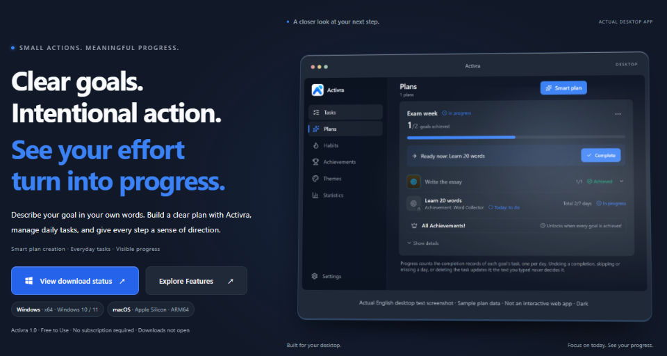
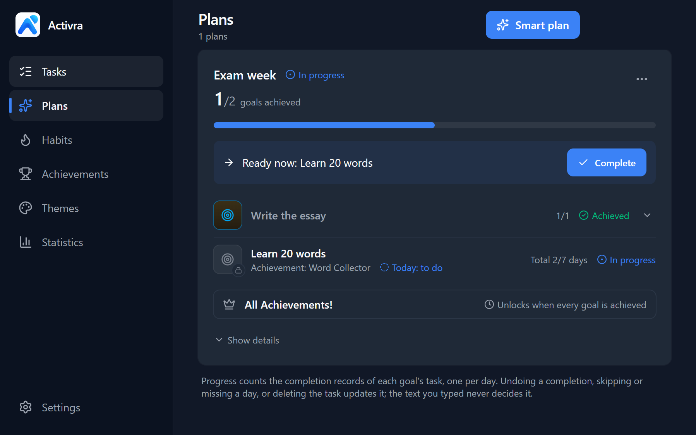
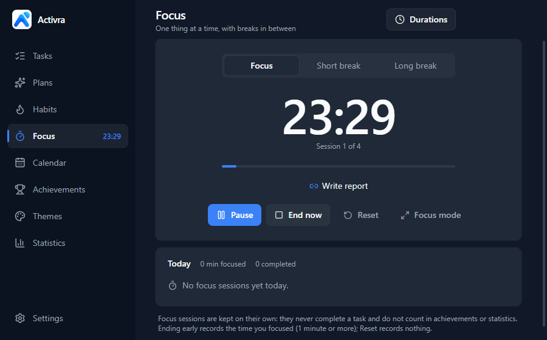
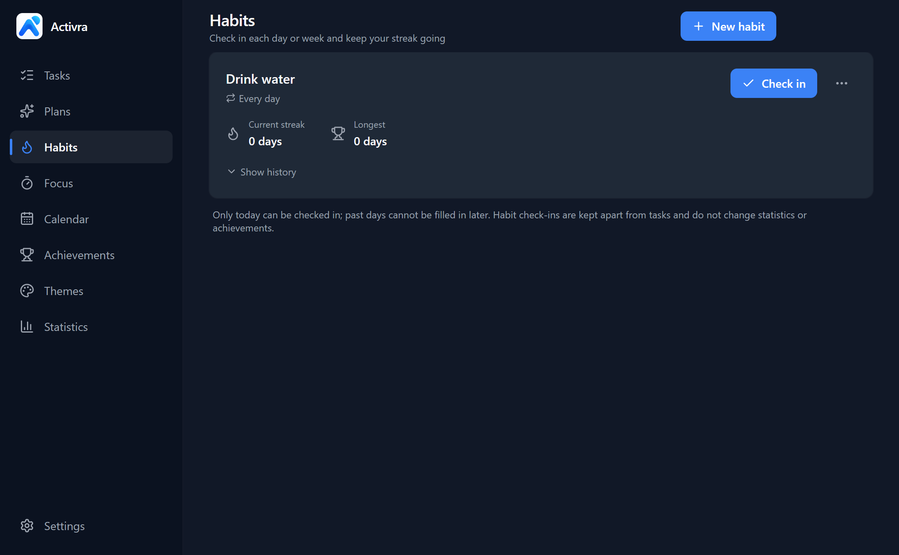
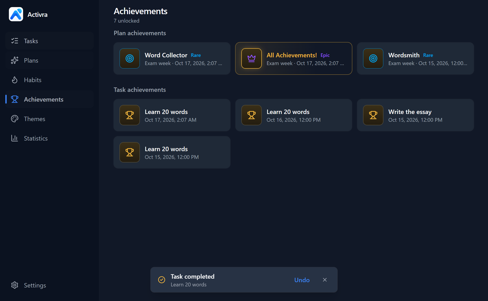

<p align="center">
  
</p>

<h1 align="center">Activra</h1>

<p align="center">
  <strong>Action · Progress · Achievement</strong><br>
  Clear goals. Intentional action. See your effort turn into progress.
</p>

<p align="center">
  <a href="README.md">简体中文</a> · <strong>English</strong>
</p>

<p align="center">
  <a href="https://github.com/Mem0ryPool/activra-desktop/releases/tag/v1.0.0-rc.4"><strong>⬇ Download the Windows preview 1.0.0-rc.4</strong></a>
</p>

<p align="center">
  
</p>

Activra is an offline-first desktop productivity app. Describe a goal in your own words and Activra turns it into a plan you can act on. Every time you finish something in real life, you unlock an achievement of your own. Its core features require no account or cloud service, and application data stays on the local device.

## What it does

- **Tasks and achievements**: create a task, mark it complete yourself, and an achievement notification appears in the corner of your desktop. Completions can be undone; repeating tasks and deadline reminders are supported.
- **Smart plans**: describe a goal in everyday language, such as "learn 20 words every day for the next 7 days". Parsing runs locally with fixed rules, with no AI or network service involved. Anything the text leaves out is asked for, never guessed.
- **Habits**: daily, weekly or chosen-weekday check-ins with current and longest streaks.
- **Focus timer**: Pomodoro-style focus and breaks. Focus time is recorded only; it never completes a task or grants a reward.
- **Calendar and review**: see completions, focus sessions, check-ins and deadlines day by day. Statistics include a monthly calendar, a yearly heatmap and an offline weekly report.
- **Achievement themes**: Classic, Enhanced, Legendary, and Custom with your own icon, colors and sound.
- **Desktop widget and tray**: see today's tasks on your desktop and complete them from the widget's right-click menu or the system tray.
- **Simplified Chinese and English interfaces**

## Screenshots

These are real desktop app screenshots taken with isolated test data and left unedited. They come from development test builds, so small details may differ from the current version.

<table>
  <tr>
    <td width="50%"><br><sub>Plans: progress and the next step at a glance</sub></td>
    <td width="50%"><br><sub>Focus: alternate focus and breaks</sub></td>
  </tr>
  <tr>
    <td width="50%"><br><sub>Habits: current and longest streaks</sub></td>
    <td width="50%"><br><sub>Achievements: every completion is recorded</sub></td>
  </tr>
</table>

## Download

| Item | Details |
| --- | --- |
| Version | [1.0.0-rc.4 (Windows preview, pre-release)](https://github.com/Mem0ryPool/activra-desktop/releases/tag/v1.0.0-rc.4) |
| System | Windows 10 / 11, x64 |
| File | `Activra-Setup-1.0.0-rc.4-x64.exe` (about 107 MB) |
| SHA-256 | `9809f3b45330a520c6fc589707931b80220a7e1f4679061afbe7eedd32f80492` |

Check the SHA-256 before installing (PowerShell):

```powershell
Get-FileHash .\Activra-Setup-1.0.0-rc.4-x64.exe -Algorithm SHA256
```

- This is a preview, not a stable release. Installation, upgrade, uninstall and rollback have not been fully verified; back up the data folder first.
- The installer is not code-signed, so Windows SmartScreen may say "Windows protected your PC". Verify the source and SHA-256 first; do not disable system security protections.
- Production email sign-in and cloud sync are not available yet.
- No macOS installer is included in this release.

## About this repository

The source in this repository was first prepared from the audited `1.0.0-rc.3` candidate baseline `b1f65184cb3ad21beac9b0f33174243000489403`; the RC4 optional email sign-in foundation was added later.

The RC4 installer was built from the frozen private RC4 source. This repository also contains open-source licensing and public documentation, third-party notices, and a development-server origin-validation fix. Its Git commits are therefore not the installer's byte-for-byte source snapshot and do not prove a byte-reproducible installer. Any future binary release must be rebuilt from this repository and separately pass install, upgrade, uninstall, signing, and hash acceptance checks.

## Development

Node.js 22 LTS (22.12 or later) and npm are required.

```bash
npm ci
npm run dev
```

Common checks:

```bash
npm run typecheck
npm run lint
npm test
npm run build
```

See [docs/windows-release.md](docs/windows-release.md) and [docs/macos.md](docs/macos.md) for platform build notes. Installers are unsigned by default, and `publish: null` prevents electron-builder from uploading artifacts automatically.

## Data and privacy

Application data lives in the system's `Life Unlocked` user-data directory (`%APPDATA%\Life Unlocked\` on Windows). The directory name remains unchanged after the public name changed to Activra so existing data remains compatible. See [docs/data-migration.md](docs/data-migration.md) for formats, backups, and migration behavior.

Tests and contributions must use synthetic data or isolated directories. Do not commit real tasks, logs, user data, credentials, installers, or other personal information.

## Feedback

Found a problem or have an idea? Tell us in [GitHub Issues](https://github.com/Mem0ryPool/activra-desktop/issues). Please search for an existing issue first, and include your Windows version, Activra version and steps to reproduce. Do not paste your data file or personal information into an issue; report security problems privately as described in [SECURITY.md](SECURITY.md).

## Contributing

Read [CONTRIBUTING.md](CONTRIBUTING.md) and [SECURITY.md](SECURITY.md) first. Run at least the type checks, lint checks, and tests relevant to your change before submitting it.

## License

Original Activra source code and documentation are available under the [MIT License](LICENSE):

`Copyright (c) 2026 Mem0ry`

`private: true` only prevents accidental publication to the npm registry. It does not restrict use of the repository under the MIT License.

The MIT License does not cover third-party components and does not automatically grant rights to the Activra name, logo, screenshots, or derived brand assets. See [THIRD_PARTY_NOTICES.md](THIRD_PARTY_NOTICES.md) and [BRANDING.md](BRANDING.md).
