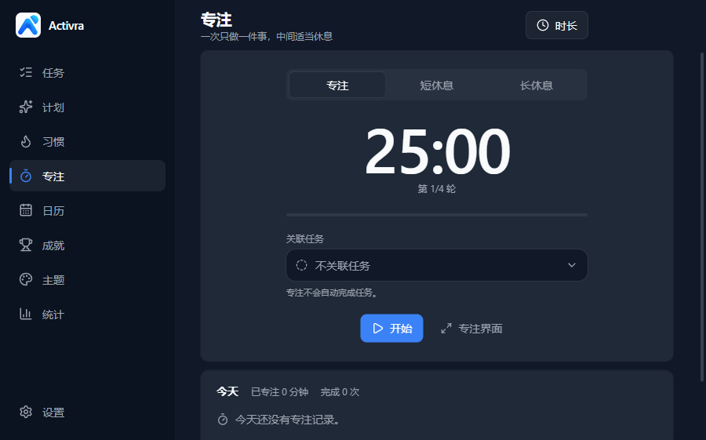
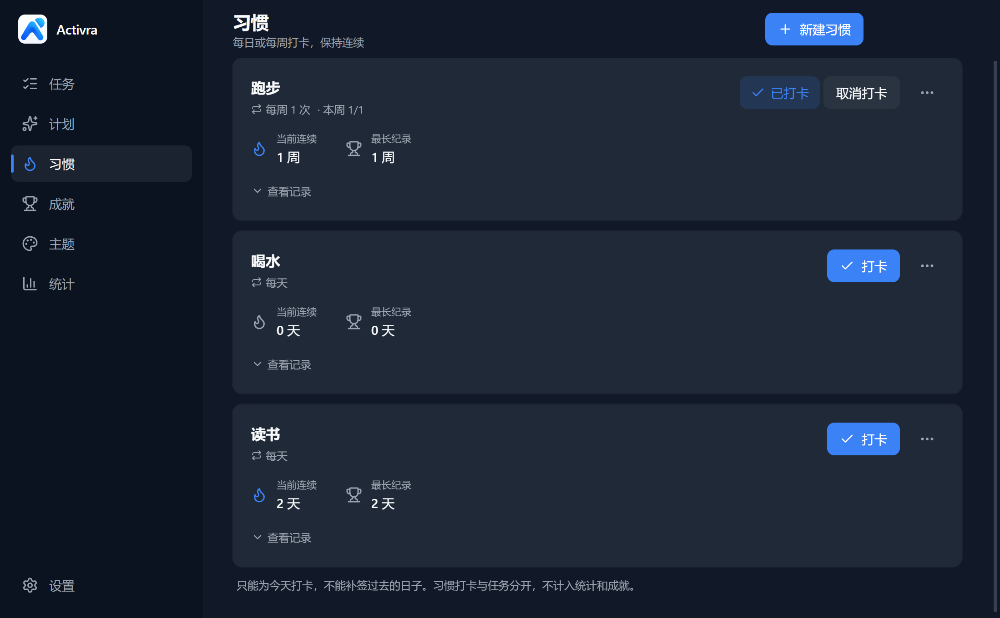
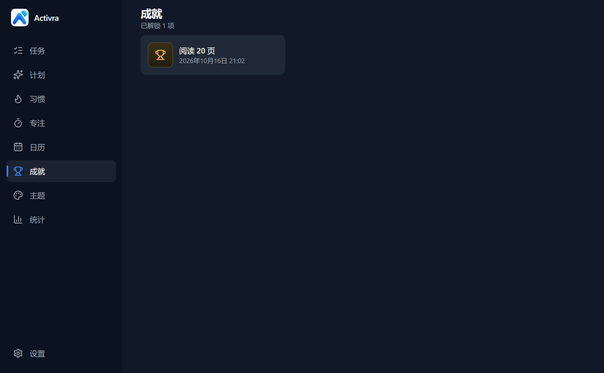

<p align="center">
  
</p>

<h1 align="center">Activra</h1>

<p align="center">
  <strong>Action · Progress · Achievement（行动 · 推进 · 成就）</strong><br>
  目标清晰，行动有序。让每一步努力，都看得见。
</p>

<p align="center">
  <a href="README.md">English</a> · <strong>简体中文</strong>
</p>

<p align="center">
  <a href="https://github.com/Mem0ryPool/Activra/releases/tag/v1.0.0-rc.4"><strong>⬇ 下载 Windows 预览版 1.0.0-rc.4</strong></a> · <a href="https://activra.pages.dev/"><strong>🌐 官方网站</strong></a>
</p>

<p align="center">
  
</p>

Activra 是一款离线优先的桌面效率应用。用自己的话写下目标，Activra 把它整理成可执行的计划；每完成一件现实中的事，你都会看到一次属于自己的成就解锁。核心功能不需要账号或云服务，应用数据保存在本机。

## 它能做什么

- **任务与成就**：创建任务，亲手点下“完成”，桌面右下角会弹出成就通知。误点可以撤销，也支持重复任务和截止提醒。
- **智能计划**：用日常语言描述目标，例如“接下来 7 天每天背 20 个单词”。解析完全在本地按规则进行，不调用任何 AI 或网络服务；缺少的信息会请你确认，而不是替你猜。
- **习惯打卡**：每日、每周或指定星期打卡，自动记录当前连续与最长纪录。
- **专注计时**：番茄钟式的专注与休息。专注只记录时间，不会替你完成任务或发放奖励。
- **日历与回顾**：按天查看完成记录、专注、打卡与截止日期；统计页提供月历、年度热力图和离线周报。
- **成就主题**：Classic、Enhanced、Legendary 与可自定义图标、颜色、音效的 Custom 主题。
- **桌面小组件与托盘**：在桌面上查看今天要做的事，右键或从系统托盘快速完成。
- **简体中文与英文界面**

## 界面

以下均为真实桌面客户端截图，使用隔离的测试数据，未经修饰。截图来自开发测试版本，个别细节可能与当前版本略有不同。

<table>
  <tr>
    <td width="50%"><br><sub>计划：进度与下一步一目了然</sub></td>
    <td width="50%"><br><sub>专注：专注与休息交替进行</sub></td>
  </tr>
  <tr>
    <td width="50%"><br><sub>习惯：连续与最长纪录</sub></td>
    <td width="50%"><br><sub>成就：每次完成都有记录</sub></td>
  </tr>
</table>

## 下载

| 项目 | 内容 |
| --- | --- |
| 版本 | [1.0.0-rc.4（Windows 预览版，pre-release）](https://github.com/Mem0ryPool/Activra/releases/tag/v1.0.0-rc.4) |
| 系统 | Windows 10 / 11，x64 |
| 文件 | `Activra-Setup-1.0.0-rc.4-x64.exe`（约 107 MB） |
| SHA-256 | `9809f3b45330a520c6fc589707931b80220a7e1f4679061afbe7eedd32f80492` |

安装前请核对 SHA-256（PowerShell）：

```powershell
Get-FileHash .\Activra-Setup-1.0.0-rc.4-x64.exe -Algorithm SHA256
```

- 这是预览版，不是稳定正式版；安装、升级、卸载和回滚流程尚未完成全面验证，操作前请备份数据目录。
- 安装程序未进行代码签名，Windows SmartScreen 可能显示“Windows 已保护你的电脑”。请先核对来源和 SHA-256，不要关闭系统安全保护。
- 正式邮箱登录与云同步尚不可用。
- 本次不提供 macOS 安装包。

## 关于本仓库

本仓库的源码最初从已审计的 `1.0.0-rc.3` 候选基线 `b1f65184cb3ad21beac9b0f33174243000489403` 准备，此后加入了 RC4 的可选邮箱登录基础。

RC4 安装包基于冻结的私有 RC4 源码构建。本仓库另外包含开源许可证/公开文档、第三方通知和开发服务器来源校验修复，因此其 Git 提交不是该安装包的逐字源码快照，也不能据此声称安装包可字节复现。若以后发布新的二进制，应从本仓库重新构建并单独完成安装、升级、卸载、签名和哈希验收。

## 开发

要求 Node.js 22 LTS（≥ 22.12）和 npm。

```bash
npm ci
npm run dev
```

常用检查：

```bash
npm run typecheck
npm run lint
npm test
npm run build
```

Windows 与 macOS 构建说明分别见 [docs/windows-release.md](docs/windows-release.md) 和 [docs/macos.md](docs/macos.md)。安装包默认不签名；构建配置中的 `publish: null` 禁止 electron-builder 自动上传产物。

## 数据与隐私

应用数据位于系统的 `Life Unlocked` user-data 目录（Windows 上为 `%APPDATA%\Life Unlocked\`）；公开名称改为 Activra 后仍保留该目录名，以兼容旧数据。格式、备份和迁移见 [docs/data-migration.md](docs/data-migration.md)。

测试和贡献必须使用合成数据或隔离目录。请勿提交真实任务、日志、用户数据、凭据、安装包或其他个人信息。

## 反馈

遇到问题或有建议，欢迎在 [GitHub Issues](https://github.com/Mem0ryPool/Activra/issues) 中告诉我们。提交前请先搜索是否已有相同问题，并附上 Windows 版本、Activra 版本和复现步骤。请不要在 Issue 中粘贴你的数据文件或个人信息；安全问题请按 [SECURITY.md](SECURITY.md) 私下报告。

## 参与贡献

请先阅读 [CONTRIBUTING.md](CONTRIBUTING.md) 和 [SECURITY.md](SECURITY.md)。提交变更前至少运行与变更相关的类型检查、lint 和测试。

## 许可证

Activra 的原创源代码与原创文档使用 [MIT License](LICENSE)：

`Copyright (c) 2026 Mem0ry`

`private: true` 仅用于防止误发到 npm registry，不限制本仓库依据 MIT License 使用源代码。

MIT License 不覆盖第三方组件，也不自动授予 Activra 名称、Logo、截图或派生品牌素材的使用权。详见 [THIRD_PARTY_NOTICES.md](THIRD_PARTY_NOTICES.md) 和 [BRANDING.md](BRANDING.md)。
